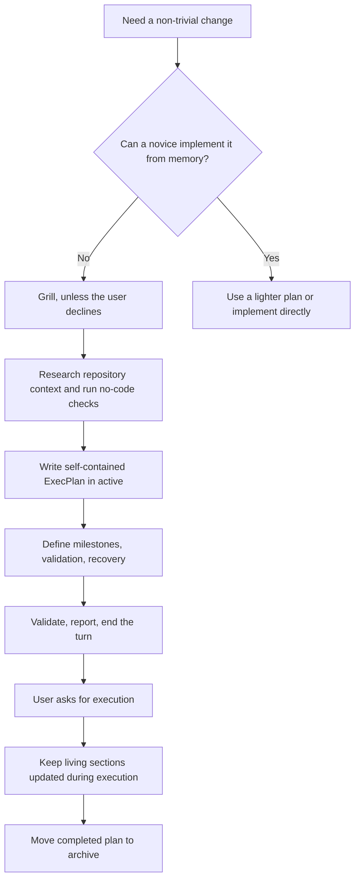

# Writing Execution Plans

## Overview

An execution plan is a self-contained, living document for work that is large, ambiguous, or risky enough that the implementer cannot rely on unstated context. The plan must tell a novice what to change, how to prove it works, and how to continue safely if work pauses and resumes later.

## Usage

When working on planning-heavy tasks and encountering:
- A request for a plan, execution plan, roadmap, implementation plan, migration plan, rollout plan, or phased approach
- A feature or refactor that will take hours, touch multiple subsystems, or require research before implementation
- A debugging or recovery effort where intermediate discoveries must be captured for the next contributor
- A user asking for assumptions, dependencies, risks, milestones, validation steps, or acceptance criteria before coding
- Terms like `ExecPlan`, "next steps", "break this down", "write the plan", or "how should we implement this"

When NOT to use:
- The task is a small, obvious change that can be completed safely without a formal plan
- The user wants brainstorming only, not an execution-ready document
- The output would be a loose checklist with no repository context, acceptance path, or recovery guidance

## Instructions

### Step 1: Decide whether a full execution plan is warranted

Write a full execution plan when the work is non-trivial to reverse, likely to span multiple sessions, or likely to fail if context is left implicit. That often means migrations, multi-file features, large refactors, incident recovery, or research-heavy implementation work.

Skip the heavyweight plan for a tiny bug fix unless the user asks for one.

### Step 2: Grill before writing

Run the `grill-me` skill and resolve what it raises before drafting, so the plan records a settled design. A skipped grill lets a plan record decisions that contradict the domain model, and nobody notices until the code is built.

Grill in every entry path:
- The user invoked this skill directly. The command names the deliverable, and the grill still comes first.
- You reached for this skill yourself on a complex feature or refactor.
- A plan is being revised or re-scoped after new evidence. Grill the new decisions before rewriting the plan text.

If you notice mid-flight that the grill was skipped, run it before any code is written.

Only an explicit decline from the user skips the grill; silence, urgency and a direct invocation all leave it on. After a decline the grill is over, so settle open design decisions requirements-first:

1. List numbered, testable requirements (`R1`, `R2`), each citing the document or incident it comes from.
2. Offer several genuinely different mechanisms, including one that replaces the current implementation.
3. Score every option against every requirement in a matrix, and mark each failure plainly.
4. Give one recommendation, plus what it forces and what it leaves open.

### Step 3: Gather repository context before writing

Base the plan on the code, docs, config, tests, and entry points it touches. The finished plan must stand on its own, so restate every assumption you rely on in the document itself.

Name repository-relative paths, important modules, and concrete commands. If the task touches multiple areas, explain how they connect so a novice can navigate the codebase.

### Step 4: Run no-code checks now, not as milestones

Run the checks the plan rests on that need no code change: baseline gates on the current tree, current dependency versions, numbers a decision rests on, and prototypes that test a theory. Record each one in `Artifacts and Notes` with what was run, its result, and the commit SHA it ran on.

Size each check to the decision it serves, and report once the result is clear enough to decide. Avoid running heavy builds at the same time on one machine, since that skews the numbers.

### Step 5: Keep code examples indented

The plan goes in a file (Step 6) with no outer triple backticks. Use indented blocks, not fences, for commands, outputs, diffs, and transcripts.

### Step 6: Use the repository plan directories

Create each new plan under `docs/exec_plans/active/`. These `docs/exec_plans/...` paths are relative to the git repository root. If the repository is not available or not yet initialized, treat them as relative to the project root as a fallback. Name the file `YYYY-MM-DD-short-plan-name.md`, where the date is the plan creation date and the suffix is a short lowercase hyphenated description.

When every remaining item in `Progress` is complete and the plan's implementation work is done, move the plan to `docs/exec_plans/archive/`. This archive path is also relative to the git repository root, with the project root as fallback. The final `Outcomes & Retrospective` and `Change Log` entries record that the plan was completed and archived.

### Step 7: Resolve repository paths versus skill-local paths

Repository files and skill helper files resolve differently.

- Repository plan paths such as `docs/exec_plans/active/` and `docs/exec_plans/archive/` are relative to the git repository root, or the project root if no git root is available.
- Skill helper paths such as `assets/execplan-template.md`, `references/plan-checklist.md`, and `scripts/validate-plan.sh` are relative to the directory holding this `SKILL.md`, shown as the skill's base directory when it loads.

### Step 8: Start from the bundled template

Start from `assets/execplan-template.md`. It encodes the required living-document structure and acceptance-oriented framing.

### Step 9: Write the plan in prose-first form

Write narrative sections as guidance for a novice, not notes to yourself. Prefer short paragraphs that explain intent, sequence, and observable results. Bullets are fine where scanning matters; only `Progress` needs a checklist.

Each plan explains:
- Why the work matters from the user's perspective
- What behavior will exist when the work is done
- What files, functions, modules, and commands are involved
- How to validate the behavior end to end
- How to recover if a step fails or the work pauses

### Step 10: Keep the required living sections current

Every execution plan maintains these sections:
- `Progress`
- `Surprises & Discoveries`
- `Decision Log`
- `Outcomes & Retrospective`

`Progress` uses checkbox items so another contributor can resume from the last stopping point. Ticked items carry a UTC timestamp, as in `- [x] (2026-04-16 12:00Z) Step`, which `scripts/validate-plan.sh` enforces; open items need none. `Decision Log` records what changed and why. `Surprises & Discoveries` captures unexpected behaviors with concise evidence. `Outcomes & Retrospective` summarizes what was achieved, remaining gaps, and lessons learned at major milestones or completion.

Add an `## Open Questions` section between `Progress` and `Surprises & Discoveries` whenever unresolved questions, ambiguities, or blockers exist. Each entry has a stable identifier in the form `OQ-001`, `OQ-002`, and so on, plus `Question`, `Context`, and `Blocking` lines. Do not renumber existing open questions when adding or resolving others. When a question is resolved, remove its entry from `Open Questions` and record the committed choice in `Decision Log`, keeping the `OQ-###` identifier in the decision note. Plans with no open questions omit the section.

### Step 11: Separate milestones from progress

Milestones tell the story of the work: goal, scope, expected result, commands to run, and the proof the reader should see. Progress items track granular status, so keep the two separate.

Each milestone is independently verifiable and moves the system toward the final user-visible outcome. A check that can run before any milestone belongs in Step 4. A check that needs an earlier milestone's result, such as live verification after a deploy, can be its own milestone.

### Step 12: Resolve ambiguity inside the plan

Make key implementation choices in the document instead of pushing them onto the future implementer. If multiple paths are viable, explain the selected approach and record the choice in `Decision Log`.

Define every non-obvious term in plain language when it first appears. Reproduce any context the plan needs instead of pointing to "as described elsewhere" or "follow the architecture doc".

### Step 13: Anchor the plan in observable outcomes

Acceptance criteria describe behavior a human can verify. State exact commands, working directories, URLs, API calls, test invocations, or UI actions, and describe the outputs the reader should observe.

Internal code structure by itself is not enough. If a change is internal, explain how to prove its effect through a test, trace, log, request, or user flow.

### Step 14: Make the plan safe to repeat

Make concrete steps idempotent where possible. If a step can partially succeed and leave the tree in an awkward state, say how to retry, roll back, or continue safely.

Destructive operations **MUST** include safeguards, backups, or fallback paths.

### Step 15: Validate the document structure

Run `scripts/validate-plan.sh` against the finished plan before handing it off, and fix what it reports. Use `references/plan-checklist.md` for a final quality pass focused on self-containment, observability, recovery guidance, and the active-to-archive lifecycle.

### Step 16: End the turn

Writing the plan ends the turn. Once it validates, report where the plan is and what is settled, then stop. Start `execute-plan` or any milestone only when the user explicitly asks for execution, even when every open question is answered and the design is approved: execution spawns subagents and can run for hours, so the user chooses when it starts.

## Supporting Files

### Template: `assets/execplan-template.md`

This is the starter skeleton for an ExecPlan, with all required living-document and execution sections. Replace its placeholders for the specific repository and task, and save the finished plan under `docs/exec_plans/active/` relative to the repository root.

### Reference: `references/plan-checklist.md`

This checklist summarizes the quality bar: self-contained context, prose-first narrative, observable validation, explicit recovery guidance, maintained living sections, and the required move from active to archive when implementation is complete.

## Deterministic Scripts

### validate-plan.sh

Validates that a Markdown plan contains the required ExecPlan sections and that `Progress` includes checkbox items. It also checks whether the file path matches the repository convention of `docs/exec_plans/active/` or `docs/exec_plans/archive/` relative to the repository root, and whether the filename follows `YYYY-MM-DD-short-plan-name.md`.

```bash
<skill-dir>/scripts/validate-plan.sh path/to/plan.md
```

Returns `✅` for passed checks, `⚠️` for warnings, and `❌` for structural errors. Exits with code `1` when required sections are missing.

## Core Concepts

### Execution plans are self-contained

A contributor should be able to read only the plan and the current working tree and still succeed. That means the plan repeats assumptions, defines terms, names files precisely, and includes the commands needed to verify success.

### Execution plans are living documents

The plan is not finished once drafting ends. As implementation proceeds, the author keeps `Progress`, `Surprises & Discoveries`, `Decision Log`, and `Outcomes & Retrospective` current so the next contributor can resume without guesswork. When present, the optional `Open Questions` section is kept current too and drains into `Decision Log` as individual questions are resolved. A plan starts in `docs/exec_plans/active/` and moves to `docs/exec_plans/archive/` only after implementation is complete.

### Outcome beats implementation detail

The plan exists to deliver observable behavior, not to enumerate code edits in the abstract. A good plan describes what a user can do after the change, how to reproduce it, and how to prove the result beyond compilation.

### Milestones tell a story; progress tracks status

Milestones explain the narrative arc of the work and the proof expected at each stage. Progress is the granular ledger of what is done, what is left, and where execution stopped.

### Plain language is mandatory

Terms like "adapter", "middleware", "RPC", or "daemon" are not self-explanatory. The plan must define them the first time they appear and tie them to concrete files, commands, or runtime behavior in the repository.

## Visual Diagrams



## Quick Reference

| Need | What the plan must include |
|------|----------------------------|
| User-visible outcome | `Purpose / Big Picture` plus behavior-focused acceptance |
| Resume after interruption | Timestamped `Progress` and current `Decision Log` |
| Multi-step delivery | Narrative milestones with proof at each stage |
| Internal-only change | Concrete evidence that still demonstrates impact |
| Risky step | `Idempotence and Recovery` guidance |
| Unresolved questions or blockers | Optional `Open Questions` section with stable `OQ-###` identifiers and `Question / Context / Blocking` entries; resolved items move to `Decision Log` |
| Repository lifecycle | Create under `docs/exec_plans/active/`, move completed plans to `docs/exec_plans/archive/` |
| Filename format | `YYYY-MM-DD-short-plan-name.md` |
| Helper file resolution | Resolve `assets/`, `references/`, and `scripts/` inside the `write-plan/` skill folder |

## Common Patterns

### Weak purpose -> outcome-focused purpose

**Before:**
> Add rate limiting middleware.

**After:**
> After this change, operators can enable request throttling for the public API and verify it by sending repeated requests to `/v1/chat/completions`; the eleventh request within one minute returns HTTP 429 instead of overwhelming the service.

### Hidden context -> novice-guiding context

**Before:**
> Update the scheduler to use the new queueing path.

**After:**
> In `services/scheduler/main.go`, replace the old in-memory dispatch call with the queue-backed `enqueueJob` path defined in `internal/queue/producer.go`. The scheduler is the process that scans due work every 30 seconds; the queue producer is the component that persists units of work for downstream workers.

### Checklist-only milestone -> narrative milestone

**Before:**
> Milestone 1:
> - add endpoint
> - add tests
> - run tests

**After:**
> Milestone 1 introduces a read-only health endpoint so the service exposes a trivial end-to-end proof path before deeper refactoring begins. At the end of the milestone, `curl http://localhost:8080/health` returns `200 OK`, and the new integration test in `tests/health_test.py` passes locally.

## Common Mistakes

### Writing a summary instead of an executable plan

**Problem:** The document says what should happen but not what files to edit, what commands to run, or what outputs to expect.
**Fix:** Add repository-relative paths, exact commands, expected results, and acceptance guidance.

### Leaving key decisions unresolved

**Problem:** The plan tells the implementer to "pick the best approach during implementation."
**Fix:** Make the choice in the plan, explain why, and record it in `Decision Log`.

### Treating living sections as optional

**Problem:** `Progress` and `Decision Log` are omitted or left stale.
**Fix:** Update the plan at each stopping point so another contributor can resume safely.

### Using jargon without definition

**Problem:** Terms of art appear without explaining how they show up in this repository.
**Fix:** Define the term immediately and point to the files, commands, or runtime behavior that embody it.

### Validating only compilation

**Problem:** The plan ends with "run tests" and never explains how a human sees the feature working.
**Fix:** Add a concrete behavioral proof path with commands, requests, UI actions, or logs and expected outputs.

### Ignoring the active/archive lifecycle

**Problem:** Plans are written in arbitrary locations or left in `docs/exec_plans/active/` after completion.
**Fix:** Create new plans in `docs/exec_plans/active/` and move them to `docs/exec_plans/archive/` when all work is complete.

### Using inconsistent plan filenames

**Problem:** Plans use ad hoc names that hide creation date or make sorting harder.
**Fix:** Name every plan `YYYY-MM-DD-short-plan-name.md` using a lowercase hyphenated suffix.

### Confusing skill helper files with repository files

**Problem:** The agent tries to resolve `assets/execplan-template.md` or `scripts/validate-plan.sh` from the repository root instead of from the skill folder.
**Fix:** Treat `assets/`, `references/`, and `scripts/` as paths inside `write-plan/`. Treat `docs/exec_plans/...` as repository-root-relative paths.
